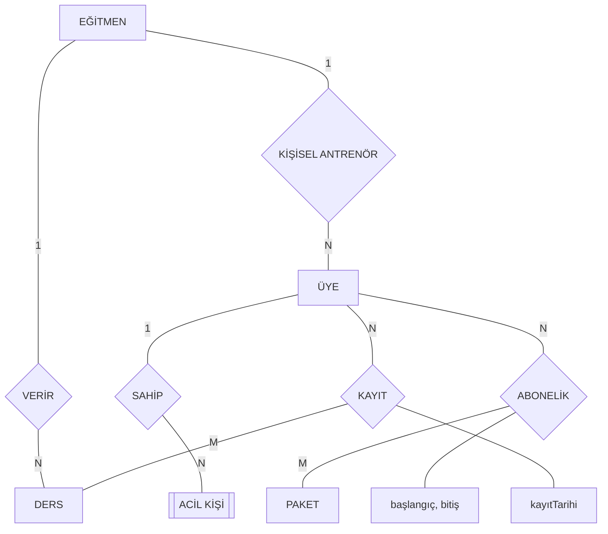

  # 02 — E-R İlişki Türleri, Katılım ve Chen Diyagramı

**Ders:** Veritabanı Yönetim Sistemleri  
**Konu:** İlişkiler, çokluklar, katılım koşulları ve Chen gösterimi  
**Sınav hedefi:** Verilen bir senaryodan ilişkileri belirlemek ve doğru E-R diyagramını çizmek.

---

## 1. İlişki (Relationship) Nedir?

İlişki, iki veya daha fazla varlık arasındaki anlamlı bağlantıyı ifade eder. Örneğin bir öğrenci bir derse kayıt olabilir veya bir eğitmen bir ders verebilir.

Chen gösteriminde varlıklar dikdörtgen, ilişkiler ise eşkenar dörtgen şeklinde çizilir. İlişki isimleri genellikle bir eylemi ifade eder: ALIR, VERİR, SAHİPTİR, KAYIT OLUR gibi.

Bir senaryoyu incelerken önce varlıkları, ardından bu varlıklar arasındaki bağlantıları belirlemek gerekir.

## 2. İlişki Çoklukları (Cardinality)

İlişki çokluğu, bir varlık örneğinin diğer varlık kümesinden en fazla kaç örnekle ilişkilendirilebileceğini ifade eder.

**Bire bir (1:1):** Bir varlık örneği karşı taraftan en fazla bir örnekle ilişkilidir. Örneğin bir çalışan en fazla bir kendisine ayrılmış dolabı kullanıyor ve her dolap en fazla bir çalışana atanıyorsa ilişki 1:1'dir.

**Bire çok (1:N):** Bir taraftaki varlık örneği karşı taraftaki birçok örnekle ilişkili olabilir, ancak karşı taraftaki her örnek en fazla birinci taraftaki tek örnekle ilişkilidir.

Örneğin bir eğitmen birden fazla ders verebilir, fakat her dersin tek bir eğitmeni vardır. Bu nedenle EĞİTMEN–DERS ilişkisi 1:N'dir.

**Çoka çok (N:M):** İki taraftaki varlık örnekleri de karşı taraftaki birden fazla örnekle ilişkili olabilir.

Örneğin bir üye birçok derse kayıt olabilir ve bir derse birçok üye kayıt olabilir. Bu nedenle ÜYE–DERS ilişkisi N:M'dir.

**Önemli:** 1:N ve N:M ifadeleri, bir ilişkinin zorunlu olup olmadığını tek başına belirtmez. Bunun için katılım koşulları ayrıca değerlendirilir.

## 3. Katılım Koşulları (Participation)

Katılım, bir varlığın belirli bir ilişkiye dahil olmasının zorunlu olup olmadığını belirtir.

**Zorunlu katılım (Total Participation):** Varlığın her örneği ilgili ilişkiye en az bir kez katılmak zorundadır. Chen gösteriminde çift bağlantı çizgisi kullanılır.

**İsteğe bağlı katılım (Partial Participation):** Bir varlık örneği ilişkiye hiç katılmayabilir. Chen gösteriminde tek bağlantı çizgisi kullanılır.

Örneğin her dersin tam olarak bir eğitmeni bulunmalıysa DERS'in katılımı zorunludur. Fakat bir eğitmen henüz hiçbir ders vermiyor olabiliyorsa EĞİTMEN'in katılımı isteğe bağlıdır.

### Minimum–maksimum katılım

| Gösterim | Anlam |
|---|---|
| (0,1) | Hiç olmayabilir veya en fazla bir olabilir. |
| (1,1) | Tam olarak bir tane olmak zorundadır. |
| (0,N) | Hiç olmayabilir veya birçok olabilir. |
| (1,N) | En az bir tane bulunmalıdır, birden fazla olabilir. |

**Sınav kuralı:** Minimum–maksimum değerlerini her varlık için ayrı ayrı yazmalıyız. Bir ilişkinin 1:N olması, bütün katılımların otomatik olarak (1,N) olacağı anlamına gelmez.

## 4. Senaryodaki İpuçlarından İlişki Belirleme

Senaryoda kullanılan ifadeler ilişki türünü ve katılımı anlamamıza yardımcı olur.

- "Tam olarak bir" ifadesi genellikle (1,1) anlamına gelir.
- "En fazla bir" ifadesi maksimum değerin 1 olduğunu belirtir. Minimum değer ayrıca değerlendirilir.
- "Olmayabilir" veya "henüz seçmemiş olabilir" ifadeleri minimum değerin 0 olabileceğini gösterir.
- "Bir veya daha fazla" ifadesi minimum 1, maksimum N anlamına gelir.
- "Birden fazla olabilir" ifadesi maksimumun N olabileceğini belirtir; minimum değer için senaryonun tamamı incelenmelidir.

Örneğin "Bir üyenin en fazla bir kişisel antrenörü olabilir" ifadesi, üyenin kesinlikle bir antrenör seçmesi gerektiği anlamına gelmez. Antrenör seçmemiş olması da mümkün olduğundan katılım aralığı (0,1)'dir.

## 5. Zayıf Varlık ve Tanımlayıcı İlişki

Zayıf varlık, kimliği başka bir varlığa bağlı olan ve kendi kısmi anahtarıyla tek başına benzersiz tanımlanamayan varlıktır.

FitZone senaryosunda ACİL KİŞİ'nin sıra numarası yalnızca ilgili üye içinde benzersizdir. Bu nedenle ACİL KİŞİ zayıf varlık, ÜYE ise güçlü varlıktır.

Chen gösteriminde zayıf varlık çift dikdörtgenle ve tanımlayıcı ilişki çift eşkenar dörtgenle çizilir.

ACİL KİŞİ'nin `sıraNo` niteliği kısmi anahtardır. İlişkisel modele dönüştürüldüğünde `(üyeNo, sıraNo)` birlikte bileşik birincil anahtar olabilir.

FitZone senaryosunda her üyenin en az bir acil kişisi bulunduğu ve her acil kişinin bir üyeye bağlı olduğu belirtilmiştir. Dolayısıyla bu ilişki 1:N'dir ve iki tarafta da katılım zorunludur.

## 6. İlişki Nitelikleri

Bazı nitelikler doğrudan bir varlığa değil, iki varlık arasındaki ilişkiye aittir.

Örneğin bir üyenin bir pakete abone olduğu tarih, yalnızca ÜYE veya yalnızca PAKET varlığına ait değildir. Bu bilgi ABONELİK ilişkisine aittir.

FitZone örneğindeki ilişki nitelikleri:

- ABONELİK: başlangıç, bitiş
- KAYIT: kayıtTarihi

Chen diyagramında ilişki nitelikleri elips şeklinde çizilir ve ilgili eşkenar dörtgene bağlanır.

İlişkisel şema oluşturulurken bu bilgilerin hangi tabloda tutulacağı, ilişkinin türüne göre belirlenir.

## 7. FitZone Senaryosundaki Varlıklar

| Varlık | Nitelikleri | Anahtar |
|---|---|---|
| ÜYE | üyeNo, ad, soyad, doğumTarihi, telefon, yaş | üyeNo |
| ACİL KİŞİ | sıraNo, ad, telefon | Kısmi anahtar: sıraNo |
| PAKET | paketNo, ad, ücret, süreAy | paketNo |
| EĞİTMEN | eğitmenNo, ad, uzmanlık | eğitmenNo |
| DERS | dersNo, ad, kapasite | dersNo |

ÜYE'nin telefonu çok değerli niteliktir ve çift elipsle gösterilir. Yaş, doğum tarihinden hesaplandığı için türetilen niteliktir ve kesikli elipsle gösterilir.

ACİL KİŞİ zayıf varlık olduğu için çift dikdörtgenle çizilir.

## 8. FitZone İlişkileri ve Katılımları

### 8.1. ÜYE — ACİL KİŞİ

İlişki türü 1:N'dir. Her üyenin bir veya daha fazla acil kişisi vardır. Her acil kişi tam olarak bir üyeye bağlıdır.

ÜYE: (1,N), zorunlu katılım.

ACİL KİŞİ: (1,1), zorunlu katılım.

Bu ilişki tanımlayıcı ilişkidir.

### 8.2. ÜYE — PAKET

İlişki türü N:M'dir. Bir üye birçok pakete abone olabilir ve bir pakete birçok üye abone olabilir.

ÜYE: (0,N), isteğe bağlı katılım.

PAKET: (0,N), isteğe bağlı katılım.

İlişkinin başlangıç ve bitiş tarihleri bulunur.

### 8.3. EĞİTMEN — DERS

İlişki türü 1:N'dir. Bir eğitmen birçok ders verebilir, ancak her ders tam olarak bir eğitmen tarafından verilir.

EĞİTMEN: (0,N), isteğe bağlı katılım.

DERS: (1,1), zorunlu katılım.

Bu nedenle DERS tarafındaki bağlantı çift çizgiyle gösterilir.

### 8.4. ÜYE — DERS

İlişki türü N:M'dir. Bir üye birçok derse kayıt olabilir ve bir derse birçok üye kayıt olabilir.

ÜYE: (0,N), isteğe bağlı katılım.

DERS: (0,N), isteğe bağlı katılım.

KAYIT ilişkisinin `kayıtTarihi` niteliği bulunur.

### 8.5. EĞİTMEN — ÜYE (Kişisel Antrenör)

İlişki türü 1:N'dir. Bir eğitmen birçok üyenin kişisel antrenörü olabilir, fakat her üyenin en fazla bir kişisel antrenörü bulunabilir.

EĞİTMEN: (0,N), isteğe bağlı katılım.

ÜYE: (0,1), isteğe bağlı katılım.

Her iki tarafta da katılım isteğe bağlı olduğundan bağlantılar tek çizgiyle gösterilir.

## 9. FitZone İlişki Haritası

Aşağıdaki Mermaid diyagramı, GitHub üzerinde varlıkların ve ilişkilerin nasıl bağlandığını hatırlamak için kullanılır. **Bu bir ilişki haritasıdır; Chen gösteriminin çift dikdörtgen, çift elips ve katılım çizgilerini birebir karşılamaz.** Sınav kâğıdında standart Chen şekilleri kullanılmalıdır.

Chen diyagramının tamamını çizerken ÜYE, PAKET, EĞİTMEN ve DERS varlıklarına anahtar ve diğer nitelik elipsleri eklenir. ACİL KİŞİ çift dikdörtgen, SAHİP çift eşkenar dörtgen olarak çizilir. ÜYE'nin telefonu çift elips, yaşı kesikli elips olmalıdır. Zorunlu katılımlar çift çizgiyle gösterilir.

## 10. Sınavda E-R Diyagramı Çizme Yöntemi

Senaryo verildiğinde önce bütün cümleleri dikkatlice okuyup varlıkları belirlemeliyiz. "Benzersiz" gibi ifadeler anahtar adaylarını bulmaya yardımcı olur.

İkinci aşamada her varlığın nitelikleri belirlenir. Çok değerli, türetilen ve kısmi anahtar nitelikler ayrıca işaretlenir.

Üçüncü aşamada varlıklar arasındaki ilişkiler bulunur. Her ilişki için iki yönden düşünülerek 1:1, 1:N veya N:M olup olmadığına karar verilir.

Dördüncü aşamada her varlığın ilişkiye minimum ve maksimum kaç kez katılabileceği belirlenir. Minimum 0 ise isteğe bağlı, minimum 1 ise zorunlu katılım söz konusudur.

Son aşamada Chen şekilleri çizilir ve ilişki nitelikleri ilgili eşkenar dörtgenlere bağlanır.

Diyagram tamamlandığında anahtarların, güçlü ve zayıf varlıkların, ilişki çokluklarının ve katılım çizgilerinin doğru olup olmadığı mutlaka kontrol edilmelidir.

## 11. Sınavda Yapılabilecek Hatalar

**1:N ile N:M'yi karıştırmak:** İlişkiyi her iki yönden okumak gerekir. Bir öğretmen birçok ders verebiliyorsa bunun tersi olarak her dersin birçok öğretmeni olduğu varsayılmamalıdır.

**Katılımı tek taraflı düşünmek:** Bir ilişkide her iki varlığın minimum–maksimum değerleri ayrı ayrı belirlenmelidir.

**1:N ilişkisini zorunlu sanmak:** Çokluk ve zorunluluk farklı özelliklerdir.

**"En fazla bir" ifadesini "(1,1)" kabul etmek:** Minimum değer 0 olabilir. Senaryodaki diğer ifadeler kontrol edilmelidir.

**İlişki niteliğini yanlış varlığa bağlamak:** Kayıt tarihi çoğu zaman ÜYE'nin değil, ÜYE–DERS kayıt ilişkisinin özelliğidir.

**Zayıf varlığı normal dikdörtgen çizmek:** Zayıf varlık çift dikdörtgenle çizilir.

**Tanımlayıcı ilişkiyi unutmak:** Zayıf varlığın kimliğinin sahip varlığa bağlı olduğu gösterilmelidir.

**Bütün ilişkileri çift çizgiyle göstermek:** Çift çizgi yalnızca zorunlu katılımı ifade eder.

**ER diyagramını ilişkisel şemayla karıştırmak:** Chen gösteriminde varlık, nitelik ve ilişkiler şekillerle gösterilir. İlişkisel şemada ise tablolar, sütunlar, PK ve FK bilgileri yazılır.

## 12. Vize İçin Hızlı Tekrar

- İlişki, varlıklar arasındaki anlamlı bağlantıdır.
- Chen gösteriminde ilişki eşkenar dörtgendir.
- 1:1, bir varlık örneğinin karşı taraftan en fazla bir örnekle ilişkili olduğunu gösterir.
- 1:N, bir taraftaki varlığın birçok karşı taraf örneğiyle ilişkilendirilebildiğini gösterir.
- N:M, her iki taraftan da birçok örneğin ilişkilendirilebildiğini gösterir.
- Zorunlu katılım çift çizgiyle, isteğe bağlı katılım tek çizgiyle gösterilir.
- (0,1) en fazla bir, (1,1) tam olarak bir, (0,N) sıfır veya birçok, (1,N) en az bir anlamına gelir.
- Zayıf varlık çift dikdörtgen, tanımlayıcı ilişki çift eşkenar dörtgendir.
- İlişkilerin de başlangıç, bitiş veya kayıt tarihi gibi nitelikleri olabilir.
- İlişki çokluğu ile katılım zorunluluğu birbirinden ayrı belirlenmelidir.

**En önemli sınav yöntemi:** Önce varlıkları bul, sonra ilişkileri iki yönden oku, çoklukları belirle, katılımı ayrı değerlendir ve son olarak Chen şekillerini yerleştir.

---

**Sonraki ders:** E-R diyagramından ilişkisel şemaya dönüşüm, PK/FK yerleşimi, 1:N ve N:M dönüşümleri, zayıf varlıklar, çok değerli nitelikler ve normalizasyon.
